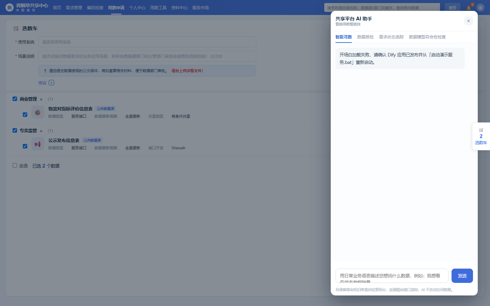

# ① 智能寻数

**定位**：只做「寻数」——自然语言找数 → 目录/字段推荐 → 选数车一键加购 → 表级血缘溯源。**不做 NL2SQL**（取数申请与实施由既有流程承接）。



## 组成

| 文件 | 说明 |
|---|---|
| `demo_server.py`（8095） | 统一演示页：共享平台选数车打底 + 右侧悬浮对话框 |
| `lineage_server.py`（8091） | 表级血缘接口模拟：`/lineage?table=x` 返回节点与依赖 |
| `catalog.json` | 虚构数据目录 200 条（编码/名称/机构/共享类型/字段/标签） |
| `generate_kb.py` | 从目录生成 Dify 知识库资产：目录库 200 / 术语库 39 / 指标口径库 22 / 权威表清单 18 / 血缘图谱 23 节点 16 边 |
| `gen_demo_catalog.py` | 虚构目录生成器（全部数据虚构） |
| `build_chatflow.py` | 调用 Dify 控制台 API 自动构建 Chatflow：意图识别 → 寻数卡片 → 血缘追问 → 通用问答 |

## 设计要点

- **知识按资产分类组织**：术语（业务语言→数据映射）、指标口径、权威表清单、血缘各自独立成库，检索时按意图路由，避免混检
- **血缘不经大模型**：表级依赖关系走结构化接口（lineage_server），模型只负责转述，防止编造
- **权威源问答**：`authority_map` 显式记录每张下游表的权威源，回答"这个数哪张表最准"有据可依

## 运行

```bash
python gen_demo_catalog.py && python generate_kb.py
python demo_server.py --port 8095     # 演示页
python lineage_server.py --port 8091  # 血缘接口（demo_server 内部调用）
```
