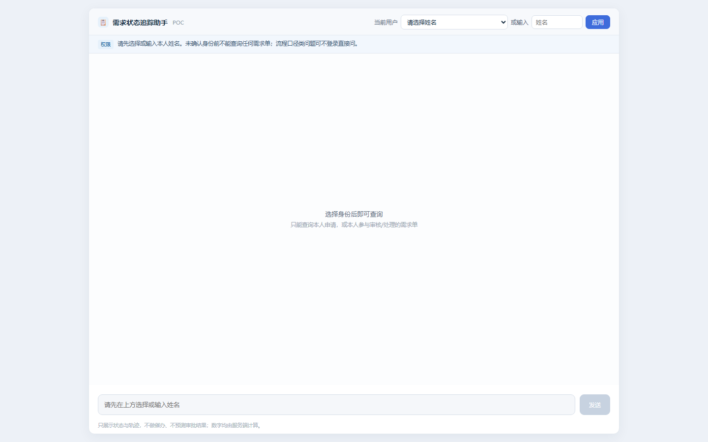

# ③ 需求状态追踪

**定位**：用数单（数据申请单）状态与轨迹查询助手。只展示状态与轨迹，**不做催办、不预测审批结果**；落库与执行由业务系统完成。



## 组成

| 文件 | 说明 |
|---|---|
| `build_demo_data.py` | 生成虚构流转库 `tracking_poc.db`：40 张用数单 × 多环节流转记录 300+ 行（21 列，与生产导出格式对齐） |
| `mock_api.py`（8094） | 状态统计、轨迹查询 API + 权限过滤 + 对话页托管 |
| `index.html` | 对话页：先选身份（姓名）才可查询，权限提示常显 |
| `build_chatflow.py` | 自动构建 Chatflow（意图分类 → 工具调用 → 结果组织） |
| `dify_api.py` | Dify 对话 API 封装（Cookie 从环境变量注入） |
| `e2e_test.py` | 端到端用例 |
| `sample_responses.json` | 演示回复样例 |

## 权限口径（本 POC 的核心设计）

- 查询必带 `user`（生产环境取门户登录态，POC 手选）
- **可见范围 = 本人申请 ∪ 本人参与审核/处理的单据**
- 越权（`denied`）**不回传任何字段**——不是"返回脱敏行"，而是整单不可见
- 统计类回答必须声明"范围为与您相关的 N 张单"

## 意图路由的两版实现

| 版本 | 实现 | 结论 |
|---|---|---|
| 直连版（推荐） | 服务端正则路由，命中即调对应工具 | 确定性高，POC 验证主用 |
| 路由版 | Dify 问题分类器分四类 | 小模型偶发误分类，需服务端兜底——**意图路由建议规则做，不交给小模型分类** |

## 运行

```bash
python build_demo_data.py      # 生成 tracking_poc.db（虚构数据）
python mock_api.py --port 8094 # http://127.0.0.1:8094
```
