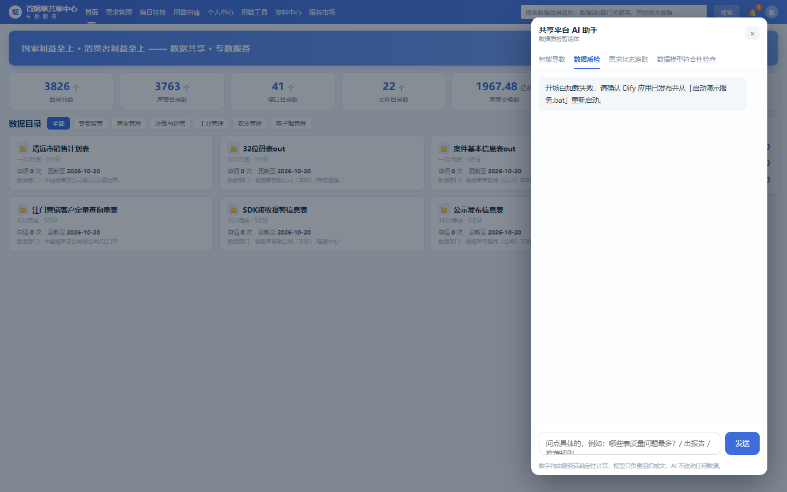
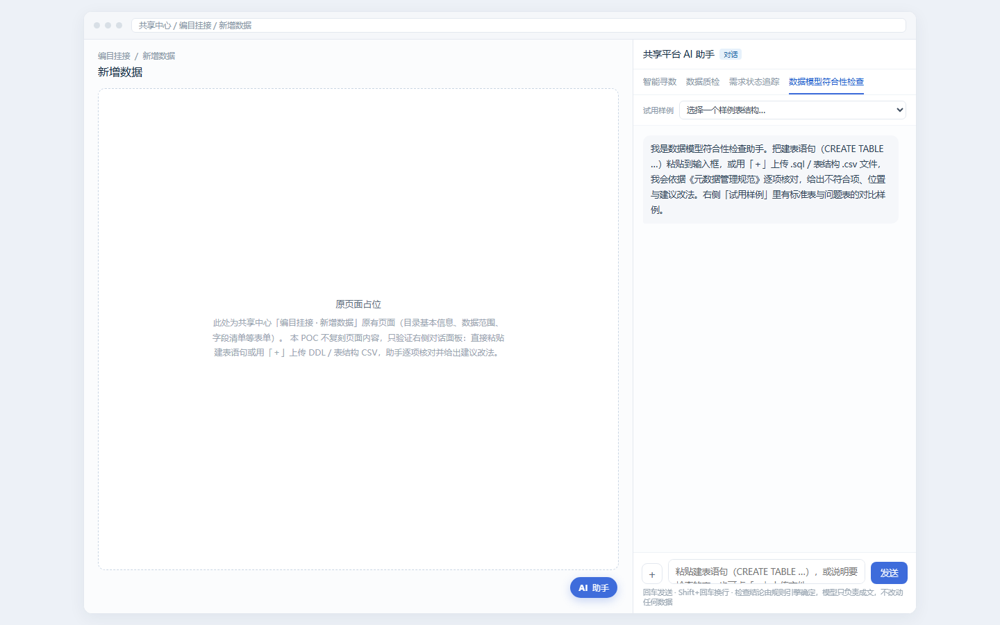
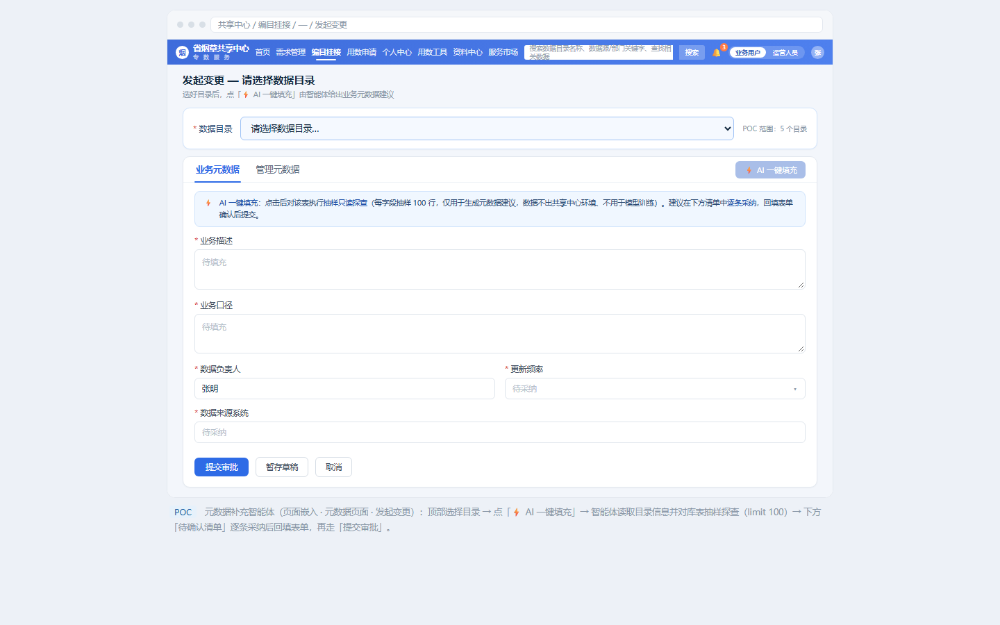

# 烟草商业企业数据共享中心智能体 · POC 验证项目

面向烟草商业企业数据共享中心的 **5 个智能体 POC 验证**：智能寻数、数据质检、需求状态追踪、数据模型符合性检查、元数据补充。

> **数据声明**：仓库内所有数据（目录、库表、工单、需求单、人员、单位）均由脚本虚构生成，不含任何真实企业与个人信息。项目背景基于 DCMM（GB/T 36073 数据管理能力成熟度评估模型）AI 专项的建设要求。

## 五个智能体

| # | 智能体 | 交互形式 | 核心能力 | 目录 | 演示服务 |
|---|---|---|---|---|---|
| ① | 智能寻数 | 对话框（门户内悬浮） | 自然语言找数 → 目录/字段推荐 → 选数车加购 → 表级血缘溯源 | [01-catalog-search](01-catalog-search/) | 8095 |
| ② | 数据质检 | 对话框 + 报告页 | 六维质检问题统计、规则执行分析、分级处理建议（可直接执行/疑似待判/现象上报） | [02-data-quality](02-data-quality/) | 8096 |
| ③ | 需求状态追踪 | 对话框（权限受控） | 用数单状态/轨迹查询：可见范围 = 本人申请 ∪ 本人参与审核，越权不回传任何字段 | [03-demand-tracking](03-demand-tracking/) | 8094 |
| ④ | 数据模型符合性检查 | 对话为首选 / 页面嵌入备选 | 建表语句（DDL）对照《元数据管理规范》逐条判定，输出不符合项+建议改法 | [04-model-compliance](04-model-compliance/) | 8093 |
| ⑤ | 元数据补充 | 页面嵌入（表单） | 目录元数据 AI 一键填充：探查库表 → 生成业务描述/业务口径/更新频率/来源系统建议（含置信度与依据） | [05-metadata-supplement](05-metadata-supplement/) | 8092 |

## 效果图

| 智能寻数 | 数据质检 |
|---|---|
|  |  |

| 需求状态追踪 | 数据模型符合性检查 | 元数据补充 |
|---|---|---|
|  |  |  |

## 设计底线

- **AI 不改数**：智能体只输出建议与分析报告，落库由人工确认、业务系统执行
- **数由代码算，话由模型说**：统计、阈值、权限判定等确定性逻辑由服务端代码完成，模型只负责理解意图与组织表达
- **权限在服务端判定**：需求追踪等涉权限场景一律由服务端过滤数据，模型侧接触不到越权数据

## 快速开始

依赖：Python 3.8+（02/05 需 `openpyxl`，仅数据构建脚本使用；服务本身零第三方依赖）

```bash
# ① 智能寻数（选数车 + 对话悬浮窗，内含表级血缘图谱）
cd 01-catalog-search
python gen_demo_catalog.py && python generate_kb.py   # 生成虚构目录与知识资产
python demo_server.py --port 8095                      # http://127.0.0.1:8095

# ② 数据质检（门户 mock + 六维统计 + 分级建议）
cd ../02-data-quality
python build_demo_data.py                              # 生成虚构质检底座 dq_poc.db
python demo_server.py --port 8096                      # http://127.0.0.1:8096

# ③ 需求状态追踪（权限受控的用数单查询）
cd ../03-demand-tracking
python build_demo_data.py                              # 生成虚构流转库 tracking_poc.db
python mock_api.py --port 8094                         # http://127.0.0.1:8094

# ④ 数据模型符合性检查（DDL 规则引擎 + 对话式检查）
cd ../04-model-compliance
python poc_server.py --port 8093                       # http://127.0.0.1:8093

# ⑤ 元数据补充（探查 + AI 一键填充）
cd ../05-metadata-supplement
python build_poc_data.py                               # 生成虚构目录与模拟库 meta_poc.db
python poc_server.py --port 8092                       # http://127.0.0.1:8092
```

## 与 Dify 的关系

各智能体的编排（Chatflow / Workflow）通过 `build_chatflow.py` / `build_workflow.py` 等脚本调用 Dify 控制台 API 自动构建——意图识别节点、知识检索节点、工具调用节点、代码节点的完整 DSL 都在脚本里，可审计、可复现、可迁移。

> 克隆后如需对接自己的 Dify 实例：复制 `.env.example` 为 `.env`，配置 `DIFY_COOKIE_FILE`（控制台 Cookie 文件）与各 `*_key.txt`（应用 API Key）。所有凭据均通过环境变量/本地文件注入，仓库内不含任何密钥。

## 目录结构

```
├── 01-catalog-search/        智能寻数：catalog.json(200条虚构目录) + 血缘 + 知识资产生成器
├── 02-data-quality/          数据质检：质检底座构建 + 六维统计 API + 分级建议知识库
├── 03-demand-tracking/       需求状态追踪：流转数据构建 + 权限过滤 API
├── 04-model-compliance/      数据模型符合性检查：22 条规则引擎 + DDL 样例
├── 05-metadata-supplement/   元数据补充：库表探查 + AI 一键填充 mock
├── entry/                    演示总入口（五智能体统一门户页）
└── docs/                     效果图
```
